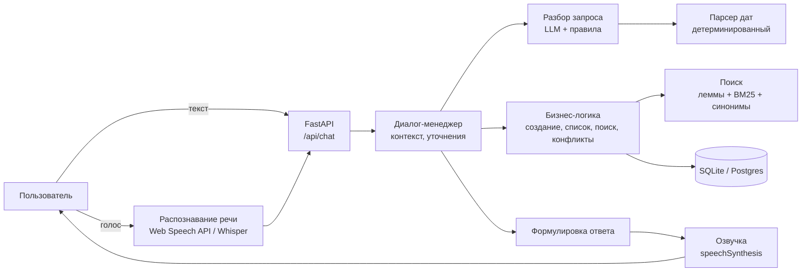

# Голосовой ежедневник

Прототип голосового ассистента для задач, напоминаний и встреч. Пользователь говорит или пишет своими словами
(«Напомни завтра в 10 утра позвонить Ивану», «Что у меня на этой неделе?», «Когда была встреча с Иваном?»),
ассистент понимает запрос, сохраняет или находит записи и отвечает текстом и голосом.

Прототип работает **бесплатно и без ключей**: речь распознаёт и озвучивает браузер, запросы разбирают правила.
Если подключить LLM (тоже можно бесплатную), ассистент лучше понимает нестандартные формулировки.

## Что умеет

**Обязательные сценарии**

| Сценарий | Примеры |
|---|---|
| Создание задачи / напоминания | «Напомни мне завтра в 10 утра позвонить Ивану», «В пятницу нужно отправить отчёт», «Поставь задачу купить билеты до конца недели» |
| Создание встречи | «Добавь встречу с командой завтра в 15:00», «В четверг в 11 у меня встреча с дизайнером» |
| Список за период | «Что у меня сегодня?», «Какие планы на сегодня?», «Покажи мои встречи на сегодня», «Что запланировано на эту неделю?» |
| Поиск старых записей | «Найди задачу про презентацию», «Когда у меня была встреча с Иваном?», «Я когда-то ставил задачу по договору, найди её» |

Понимаются относительные даты и время: сегодня, завтра, послезавтра, в пятницу, через два часа, на следующей
неделе, до конца недели, в выходные, 20 ноября в 9:30, в 3 дня, в половине третьего, утром и т.д.

**Дополнительно**

- Уточняющие вопросы: «Поставь встречу с Иваном завтра» → «На какое время поставить встречу?». Если время уже прошло, ассистент переспросит.
- Контекст диалога: «А перенеси её на завтра», «Перенеси на час позже», «Отметь выполненной».
- Изменение, удаление и отметка выполнения голосом. Если подходит несколько записей, ассистент перечисляет варианты и просит выбрать («вторую»).
- Отметку можно снять, если её поставили случайно: галочкой в плане или голосом («Сними отметку», «Верни в работу задачу про билеты»). Вопросы «Что не выполнено?» и «Что я уже сделал на этой неделе?» фильтруют по статусу.
- Повторяющиеся задачи, встречи и напоминания: «Каждый понедельник в 10 у меня планёрка», «Напоминай по будням в 9 пить воду», «Каждые 2 недели по пятницам созвон», «Оплатить интернет 15 числа каждого месяца». Повторения показываются в списках и плане, учитываются в поиске, напоминаниях и конфликтах; выполненным отмечается конкретное повторение.
- Одно повторение или вся серия — как в Google Календаре. Если день назван («Перенеси планёрку в понедельник на 12», «9 ноября планёрки не будет», «Пропусти зарядку в среду»), меняется только он; если сказано «всю серию» или «все планёрки» — вся серия; иначе ассистент спросит: «Удалить только в понедельник, 26 октября, или всю серию?». В плане «×» у повторяющейся записи предлагает «Только этот день» или «Всю серию».
- Календарь: экспорт в `.ics` и ссылка для подписки из Google, Яндекс или Apple Календаря (`/calendar/<пользователь>.ics`). Серии выгружаются с правилом повторения, напоминания — с оповещением.
- Конфликты встреч: «В это время уже есть встреча … Всё равно добавить?», при отказе ассистент спросит другое время.
- Поиск близких по смыслу формулировок: падежи («Иваном» → «Иван»), синонимы («контракт» → «договор», «созвон» → «встреча»), сокращения («ТЗ», «КП»), опечатки («презинтация»). Опционально поиск дополняется эмбеддингами.
- Напоминания срабатывают: открытая страница показывает и озвучивает их в нужное время.
- Несколько пользователей на уровне API (заголовок `X-User-Id`).
- Работа текстом и голосом, ответы голосом (можно выключить).

## Быстрый старт

Нужен Python 3.11+.

**Windows:** дважды щёлкните `start.bat`. Он создаст окружение `.venv`, поставит зависимости, запустит сервер
и откроет страницу в браузере. Остановить сервер — закрыть окно.

**Вручную (любая ОС):**

```bash
python -m venv .venv && source .venv/bin/activate     # Windows: .venv\Scripts\activate
pip install -r requirements.txt
python -m app
```

Откройте http://localhost:8000. При первом запуске база (`data/assistant.db`) создаётся и наполняется
1000 событиями из `data/events_seed.csv`.

Голосовой ввод работает в Chrome, Edge и Safari: нажмите на зелёную кнопку микрофона или Ctrl+Пробел.
Микрофон браузер даёт только на `localhost` или по HTTPS.

**Docker**

```bash
docker build -t voice-planner .
docker run -p 7860:7860 voice-planner        # http://localhost:7860
```

**Тесты и оценка качества понимания**

```bash
pip install -r requirements-dev.txt
pytest                                  # 147 тестов: даты, повторения, разбор фраз, поиск, диалоги, API, .ics
python scripts/eval_nlu.py              # точность разбора на наборе фраз eval/phrases.jsonl
python scripts/eval_nlu.py --nlu llm    # то же с подключённой LLM
python scripts/reset_db.py              # пересоздать базу из CSV
python scripts/make_icons.py            # пересобрать иконки сайта из design/icon-source.jpg
```

## Подключение LLM (бесплатно)

Код работает с любым провайдером, у которого OpenAI-совместимый API: нужно заполнить `LLM_BASE_URL`, `LLM_API_KEY`,
`LLM_MODEL` в `.env` (шаблон — `.env.example`). Обучать модель не нужно — используется готовая, с промптом и примерами.

| Вариант | Как подключить | Заметки |
|---|---|---|
| **GigaChat** | Прокси [gpt2giga](https://developers.sber.ru/docs/ru/gigachain/tools/utilities/gpttogiga-proxy-server) поднимает OpenAI-совместимый API на `http://localhost:8090/v1` | Бесплатный пакет токенов для физлиц на 12 месяцев, официально доступен в России |
| **Groq** | `https://api.groq.com/openai/v1`, модель `llama-3.3-70b-versatile` | Бесплатный тариф с лимитами по запросам; там же бесплатный Whisper для распознавания речи |
| **OpenRouter** | `https://openrouter.ai/api/v1`, модели с суффиксом `:free` | Небольшой дневной лимит запросов |
| **Ollama** | `http://localhost:11434/v1`, например `qwen2.5:7b` | Полностью локально и бесплатно, нужен компьютер помощнее |

Условия бесплатных тарифов и доступность сервисов из разных стран меняются — перед выбором проверьте актуальные.
Если LLM не отвечает или вернула что-то невалидное, ассистент незаметно для пользователя переключается на правила.

## Архитектура



| Слой | Модуль | Что делает |
|---|---|---|
| Голос | `app/static/app.js`, `app/voice/stt.py` | Распознавание и озвучка в браузере; серверный STT как запасной вариант |
| API | `app/main.py` | HTTP-эндпоинты, раздача страницы |
| Диалог | `app/dialog/manager.py`, `session.py`, `phrases.py` | Состояние разговора, уточняющие вопросы, выбор из вариантов, тексты ответов |
| Понимание запроса | `app/nlu/` | `llm.py` — LLM, `rules.py` — правила, `hybrid.py` — связка и страховка |
| Даты | `app/timeparse/ru.py`, `repeat.py` | Русские выражения даты, времени и повторения → даты, периоды, правило RRULE |
| Бизнес-логика | `app/services/items.py`, `ics.py`, `app/recurrence.py` | Создание, выборка за период, поиск, конфликты, изменения, серии, экспорт в календарь |
| Поиск | `app/search/` | Лемматизация (pymorphy3), BM25, синонимы, нечёткое совпадение, эмбеддинги |
| Данные | `app/storage/` | SQLAlchemy-модель, репозиторий, импорт CSV |

Слои зависят только «вниз»: диалог не знает про SQL, бизнес-логика не знает про формулировки, а LLM можно
заменить или выключить без изменений в остальном коде. Зависимости собираются в `app/container.py`.

## Принятые решения

**LLM не считает даты.** Модель только вырезает из реплики фразу о времени («завтра в 10 утра»), а конкретную дату
вычисляет детерминированный парсер. Небольшие бесплатные модели часто ошибаются в календарной арифметике,
а парсер покрыт тестами и ведёт себя одинаково с любой LLM и без неё.

**LLM + правила вместо одной LLM.** Правила закрывают все сценарии из задания и работают без сети, ключей и
лимитов. LLM добавляет гибкость на нестандартных формулировках. Если LLM упала или пропустила поле (например,
время), правила подстраховывают. Поэтому прототип стабилен даже на бесплатных тарифах с лимитами.

**Голос в браузере.** Web Speech API и speechSynthesis бесплатны, не требуют сервера и отвечают быстро.
Серверное распознавание (любой Whisper-совместимый API) подключается одной переменной — для Firefox и лучшего качества.

**Поиск: леммы + BM25 + синонимы + нечёткость.** В исходных данных слова стоят в «неправильных» падежах
(«Позвонить Иваном», «по мобильному приложению»), а пользователь говорит «встреча с Иваном». Лемматизация
приводит всё к начальной форме, BM25 ранжирует, словарь синонимов и сокращений ловит близкие по смыслу слова,
нечёткое сравнение — опечатки распознавания. Всё работает на CPU за десятки миллисекунд на 1000 записей.
Эмбеддинги подключаются опционально и смешиваются с лексической оценкой.

**Выдача поиска.** Совпадений бывает много (про «презентацию» — около сотни записей), поэтому результаты сортируются
сначала по релевантности, а среди равных — по близости к сегодняшнему дню: ближайшие будущие, затем недавние
прошедшие. На вопрос «когда была…» ассистент называет последнюю прошедшую запись, на «когда будет…» — ближайшую.

**Тип записи в CSV.** В файле нет типа, он определяется по первому слову: «Встреча», «Созвон», «Демо», «Провести»,
«Обсудить» — встреча; «Напомнить» — напоминание; остальное — задача. Встречам ставится длительность 60 минут
для проверки конфликтов.

**Трактовка неоднозначностей.** «В 3» без уточнения — 15:00 (деловой контекст, 1–7 считаются дневными часами).
Время без даты, которое уже прошло, — завтра. «В пятницу», сказанное в пятницу, — сегодня; «в следующую пятницу» —
пятница следующей календарной недели. «Задачи» в вопросах включают и напоминания. Встреча и напоминание
без времени не создаются — ассистент уточняет; задачу без даты можно создать.

**Повторения в формате iCalendar.** Серия хранится одной записью с правилом RRULE («FREQ=WEEKLY;BYDAY=MO»)
и датой первого повторения, конкретные даты разворачиваются на лету (dateutil). Тот же формат без преобразований
уходит в `.ics`, поэтому календари показывают серию так же, как ассистент. Выполненные повторения хранятся
списком дат: отметка у одного понедельника не трогает остальные и снимается обратно. Перенос серии
(«перенеси планёрку на среду» → «всю серию») меняет день недели и время всех будущих повторений.

**Одно повторение — тоже по iCalendar.** Удалённый день добавляется в список исключённых дат серии (EXDATE).
Перенесённое повторение становится отдельной записью со ссылкой на серию и исходную дату, а его день тоже
исключается из серии. Поэтому в `.ics` всё видно без дополнительной логики: серия с EXDATE плюс отдельное событие
в новое время. При удалении серии её перенесённые повторения удаляются вместе с ней. В команде переноса
«откуда» и «куда» различаются по первому «на», после которого идёт время: в «перенеси планёрку в понедельник
на 12» «в понедельник» — какое повторение, «на 12» — новое время.

**Хранение.** SQLite через SQLAlchemy: ноль настройки для прототипа, Postgres подключается переменной `DATABASE_URL`
(нужен драйвер `psycopg[binary]`). Даты хранятся в часовом поясе пользователя (`TIMEZONE`, по умолчанию Москва).
Состояние диалога живёт в памяти процесса — для одного инстанса этого достаточно. Новые колонки
(правило повторения, выполненные даты) досоздаются в существующей базе при старте, данные не теряются.

## API

| Метод | Путь | Назначение |
|---|---|---|
| POST | `/api/chat` | `{text, session_id}` → ответ, текст для озвучки, найденные записи, чего ассистент ждёт |
| GET | `/api/items/upcoming?days=7` | Записи на ближайшие дни |
| GET | `/api/items/search?q=...` | Поиск |
| POST | `/api/items/{id}/complete?on=ГГГГ-ММ-ДД` | Отметить выполненной (для серии — повторение на дату `on`) |
| POST | `/api/items/{id}/reopen?on=ГГГГ-ММ-ДД` | Снять отметку о выполнении |
| GET | `/api/calendar.ics` | Скачать календарь текущего пользователя |
| GET | `/calendar/{пользователь}.ics` | Ссылка для подписки из Google / Яндекс / Apple Календаря |
| DELETE | `/api/items/{id}?on=ГГГГ-ММ-ДД` | Удалить (у серии с `on` — только повторение в этот день) |
| GET | `/api/reminders/due` | Наступившие напоминания (для уведомлений на странице) |
| POST | `/api/stt` | Распознать аудиофайл (если настроен серверный STT) |
| GET | `/api/status` | Режим разбора, текущее время сервера, число записей |

Интерактивная документация: http://localhost:8000/docs. Заголовок `X-User-Id` разделяет данные пользователей.

## Деплой

Прототипу нужен только Docker и HTTPS (без HTTPS браузер не даст микрофон).

- **Hugging Face Spaces** (бесплатно): создать Space типа Docker, загрузить репозиторий; порт 7860 уже задан в Dockerfile.
- **Render / Railway / любой VPS**: собрать по Dockerfile, переменная `PORT` подхватывается автоматически.

После деплоя календарь можно подписать по ссылке: кнопка «Ссылка для подписки» под планом копирует адрес,
в Google Календаре он добавляется через «Другие календари» → «Добавить по URL». Календари обновляют подписку
сами, обычно раз в несколько часов.

На бесплатных тарифах диск обычно временный: после перезапуска база пересоздаётся из CSV. Для демо этого достаточно,
для постоянного хранения укажите внешний Postgres в `DATABASE_URL`.

## Ограничения и что улучшить

- **Качество понимания.** На наборе `eval/phrases.jsonl` правила разбирают все 70 фраз, но набор составлялся вместе
  с правилами. На новых формулировках, под которые правила не подгонялись, первый прогон дал 12 из 20 полностью верных
  разборов (после исправлений — 20 из 20). Следующий шаг — собрать фразы от реальных людей вслепую,
  прогнать через `eval_nlu.py` с LLM и без, и решать по цифрам.
- **Семантический поиск.** Сейчас основа лексическая с синонимами; эмбеддинги стоит хранить в базе (pgvector)
  и подобрать модель под русский язык.
- **Повторения**: нет даты окончания серии («до конца года»), правил вроде «последняя пятница месяца» и варианта
  «это и все следующие». Удалённое повторение нельзя вернуть голосом — только создать заново.
- **Календарь** — односторонний: изменения в Google Календаре не возвращаются в ассистента. Для двусторонней
  синхронизации нужен CalDAV или API календаря. Ссылка подписки сейчас не защищена — нужен секретный токен в адресе.
- **Настоящие уведомления**: сейчас напоминание срабатывает, только если страница открыта; нужны Web Push или Telegram-бот.
- **Авторизация** вместо доверия заголовку `X-User-Id`, хранение сессий диалога в Redis для нескольких инстансов.
- **Голос**: потоковое распознавание и более естественный синтез (например, серверный TTS), прерывание ответа голосом.
